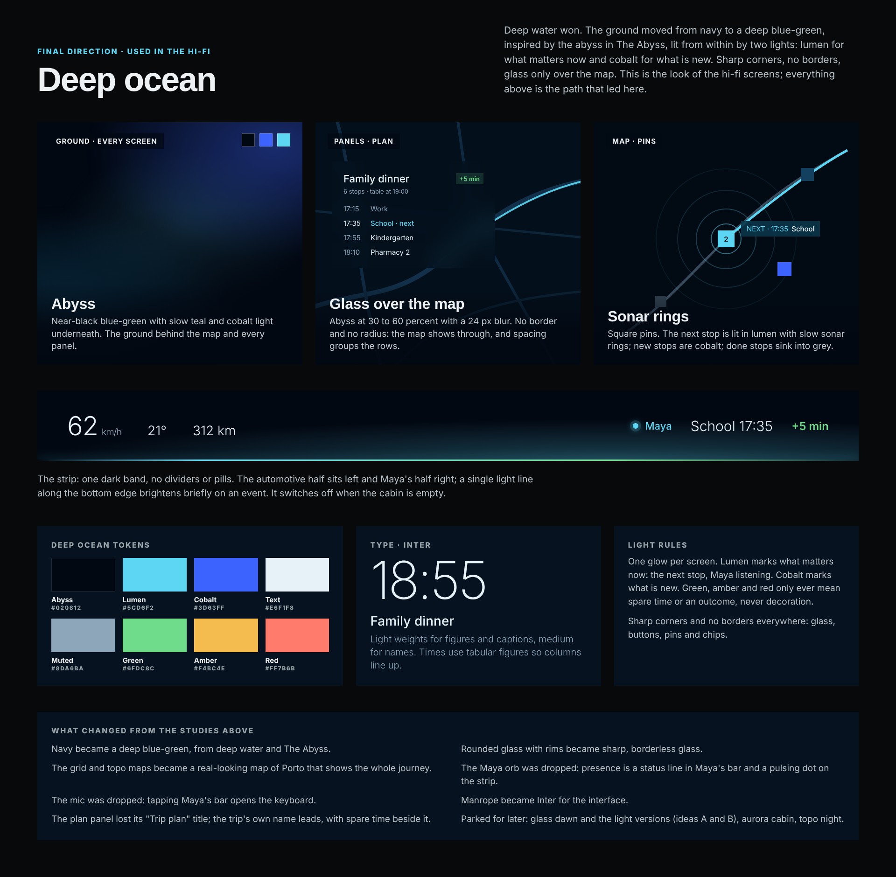

# Screen Specs and Mood Board

Twenty screens on the Central Display in story order (S01 to S20), five for courier mode (C1 to C5, two of them view only on Michael's phone), two variants (V1, V2), one system layer (F1) and a passive Panoramic Vision band: the Central Display holds everything interactive, Panoramic Vision only lets people glance.

## The two screens

| | Central Display | Panoramic Vision |
|---|---|---|
| Hardware | Large touchscreen, like today's infotainment | A band at the base of the windscreen, as in BMW Panoramic Vision |
| Role | All detail and interaction | Passive, glanceable, secondary information |
| Input | Touch | None (not touchable) |
| Content rule | Everything | Nothing unique: a copy of what is on the Central Display |

Panoramic Vision is split in half: one half is automotive data (speed, temperature, range), the other half belongs to Maya. A third surface, Michael's phone, appears only in courier mode, when nobody is in the car.

## Screen inventory

Screen IDs follow the story and are used across all artifacts.

| ID | Screen | Scene | What it shows |
|---|---|---|---|
| **S01** | Sign in | 1 | The car expects Michael and looks for his face; PIN or password as fallback; "Not Michael? Switch profile" |
| **S02** | Welcome | 1 | "Welcome back, Michael", synced data, the "Going home" default route already moving, Maya's greeting, "Full access" with Adjust |
| **S03** | Maya's access | 1 | Opened from Adjust: what Maya may do on her own (calls, payments from Maya Wallet up to a limit, plan changes from what she hears, messages), listening settings, synced data |
| **S04** | Briefing: listening | 2 | Maya listening; the "New plan" card (occasion, where, when, pick up, to do) fills in as Michael talks |
| **S05** | Briefing: keyboard | 2 | Touch twin: Maya's bar becomes a text field, with the keyboard in the lower half |
| **S06** | Briefing: Maya asks | 2 | Maya's question with a search field for the answer (no suggested answers); details filled in so far |
| **S07** | Briefing: building the plan | 2 | "This is what Maya understood", every detail still editable, while the plan is built |
| **S08** | Retailer calls | 3 | Silent live transcripts, hold timer, reference number, "pay now", chosen pharmacy; the pharmacy pin is dotted until confirmed |
| **S09** | Plan change: automatic | 3 | Banner plus ledger, no input: pharmacy 1 crossed out, pharmacy 2 marked changed |
| **S10** | Gift suggestion | 4 | The florist, delivery time and payment; Yes, order or No thanks (no bouquet choices) |
| **S11** | Florist order | 4 | Order steps: called, delivery agreed, payment successful, delivery committed; Show call |
| **S12** | Plan overview | 5 | Timeline and map, spare time (+5 min), stop cards, completed stops greyed out; replaces the provisional "Going home" route |
| **S13** | Vehicle intent | 6 | What the car is about to do at the next stop: where it pulls in, which doors unlock, how long it waits |
| **S14** | Active trip | 6 | Now and next, spare time, "Done for you" ledger (Undo on the latest row), pickup states, Edit plan |
| **S15** | Edit plan | 6 | Drag to reorder or move a stop, add or remove, ripple preview, Apply or Cancel |
| **S16** | Incoming call | 7 | Incoming-call overlay over the active trip |
| **S17** | Plan change: ambient | 7 | Heard phrase, cancelled stop crossed out, new stop marked, Undo |
| **S18** | Errand suggestion | 8 | The dry cleaner's message and Maya's offer to collect the suit after the drop-off, then wait nearby for his call; Yes or No thanks |
| **S19** | Errand booked | 8 | The call to the dry cleaner (live transcript), payment, the agreed handover (19:20, rear right door, on a hanger, code sent) and a new plan row after the restaurant |
| **S20** | Arrival report | 9 | Full-screen report: arrived on time, spare time earned, everything done with times, and the next step (courier: dry cleaner 19:20, then the car waits for his call) |
| **C1** | Leaving in courier mode | 9, 10 | "Please take your belongings", the cabin check (empty, nothing left behind), where the car is going and when it will be back |
| **C2** | Phone: courier run | 10 | View only: live map and steps (to the dry cleaner, handover, then charging until he calls), in the My BMW app, the door being used |
| **C3** | Phone: errand report | 10 | View only: photo of the suit on the hanger, receipt, times, what the camera saw |
| **C4** | Errands | any time | Opened by the box icon beside Settings: upcoming, running and done errands; New errand |
| **C5** | New errand | any time | What, where, when, handover (a compartment on a top view of the car, and how the other person gets in), instructions, payment, if it fails, afterwards (what the car does next), report |
| **V1** | Takeover request | variant | Level 3 or 4 only, outside the Level 5 scope: countdown to take over; Maya pauses every task |
| **V2** | Running late | edge case 2 | Fixes, cheapest first: ask the restaurant to hold the table, take a faster road, ask the wife to wait at the corner |
| **F1** | Maya presence | all | Listening, thinking, speaking, on a call; live captions; tap to type; mirrored on Panoramic Vision |

**Errands entry:** a box icon left of the settings cog on every Central Display screen. **The phone** is a third surface, for courier mode only and view only: two screens, the live run (C2) and the report (C3). **Charging** is not an errand and never appears in the plan list.

## Panoramic Vision: Maya's half

```
[ 62 km/h · 21° · 312 km ]  |  [ ◉ Kindergarten 17:55 · ●●○○○ · +5 min ]
   automotive half                    Maya's half
```

Short text only (about 25 characters), always with text so colour is never the only signal.

| Slot | Content | Behaviour |
|---|---|---|
| 1. Presence | Idle, listening, speaking, on a call | Small pulse |
| 2. Next stop | Icon, short label, arrival time | Updates as stops complete |
| 3. Spare time | "+5 min" | Green above 4 min, amber 0 to 4, red below 0 |
| 4. Progress (optional) | Squares for done, current, upcoming stops | Static |
| Events | "Plan updated", "Pharmacy changed", "Flowers confirmed", "Flowers delivered", "Pickup moved: hair salon", "Errand booked: dry cleaner" | 4-second takeover of slots 2 and 3 |

**Never on Panoramic Vision:** transcripts, maps, editing, anything interactive or long, medication names, personal data.

**When the cabin is empty** (courier mode), Panoramic Vision is off.

## Panoramic Vision through the story

| Scene | Screen | Panoramic Vision (Maya's half) |
|---|---|---|
| 1 | S01, S02 | ◉ Home 17:48, once signed in |
| 2 | S04 to S07 | ◉ listening · Home 17:48 |
| 3 | S08, S09 | ◉ Calling Pharmacy 2, then "Pharmacy changed · +5 min" |
| 4 | S10, S11 | ◉ speaking, then ◉ Calling Main St Florist, then "Flowers confirmed" |
| 5 | S12 | School 17:35 · +5 min |
| 6 | S13, S14 | Next stop updates: School 17:35, Kindergarten 17:55, Pharmacy 2 18:10 |
| 7 | S16, S17 | "Pickup moved: hair salon · +5 min", then Hair salon 18:30 |
| 8 | S18, S19 | ◉ speaking, then ◉ Calling the dry cleaner, then "Errand booked: dry cleaner" |
| 9 | S20, C1 | Arrived 18:55 · +5 min, then "Courier · waits for you" |
| 10 | C1 to C3 | Off (cabin empty) |

## Principles these screens follow

1. The Central Display is for interaction, Panoramic Vision is for glances.
2. The screen is the confirmation, so Maya does not read plans back.
3. Spare time is always visible.
4. Every change (world, conversation, user) shows what was removed and what is new: cancelled stops are crossed out, new stops are marked.
5. The phone is view only and appears only when the car is alone.

## Mood board

The final visual direction, **Deep ocean**: dark first, a deep blue-green ground with cobalt and lumen glows, inspired by The Abyss. In a dark cabin at night, light can carry meaning. Panoramic Vision is always dark.


